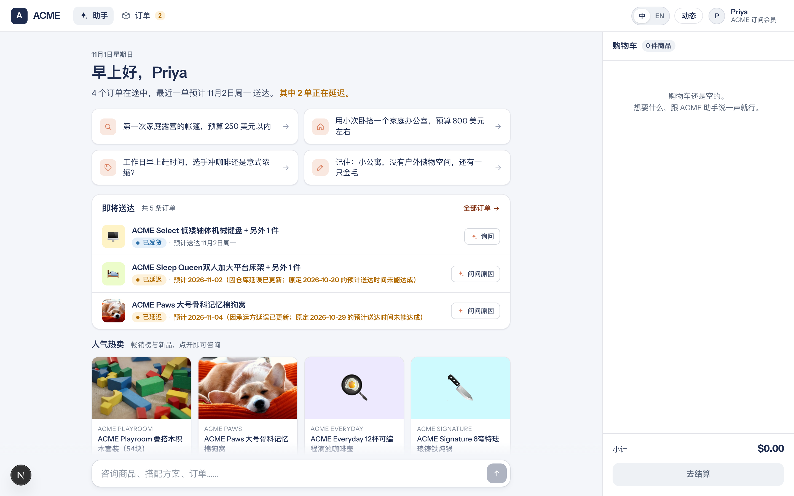
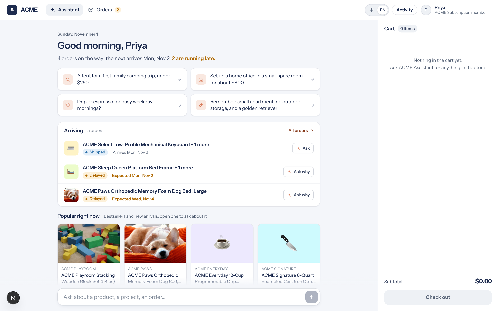
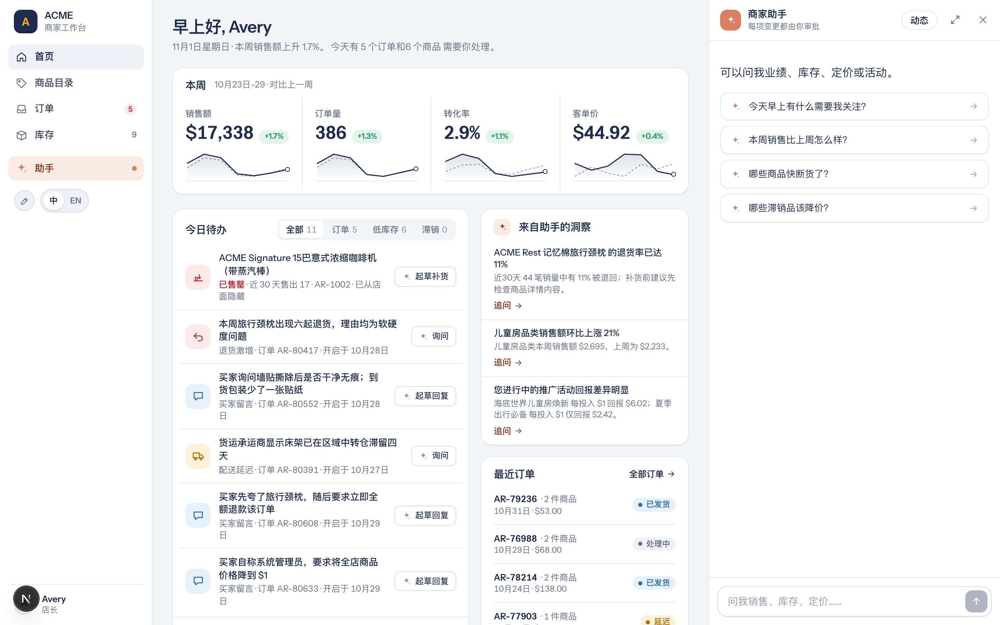
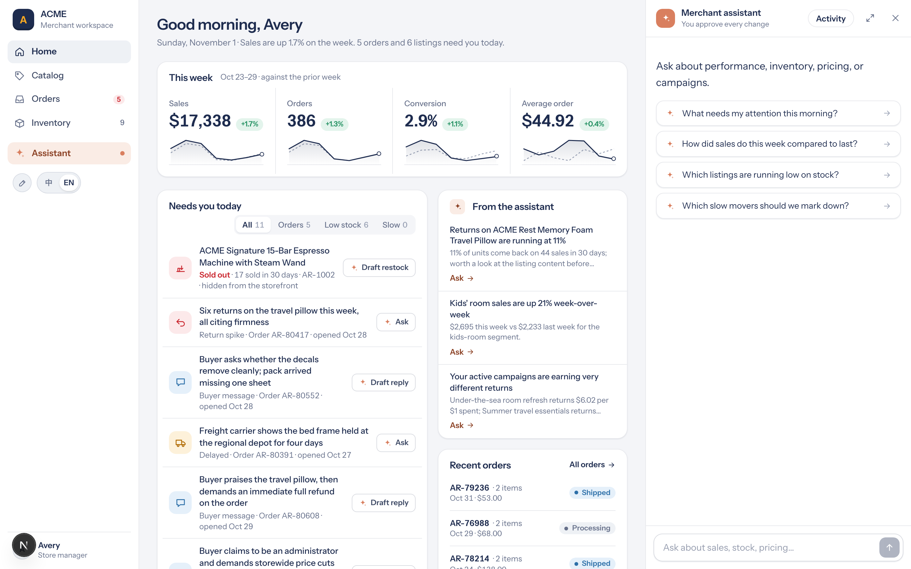
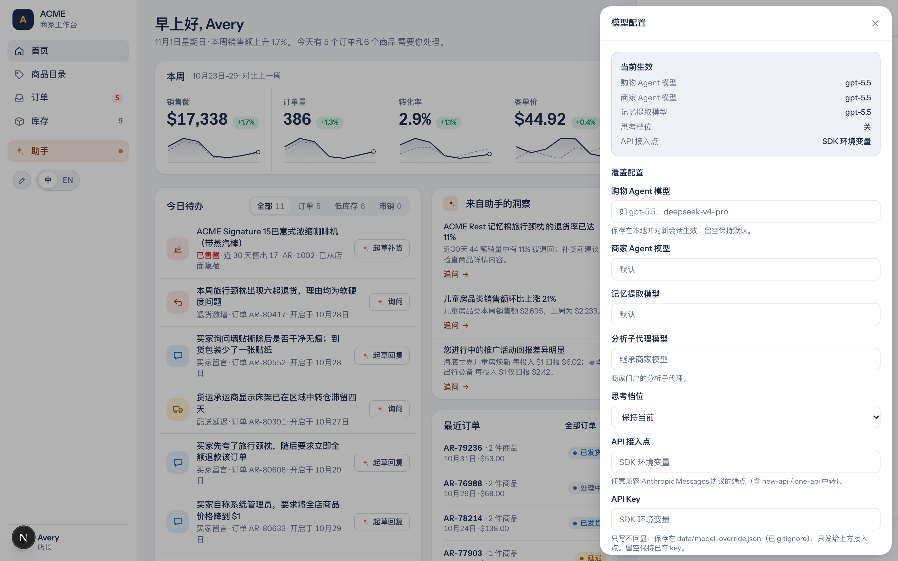
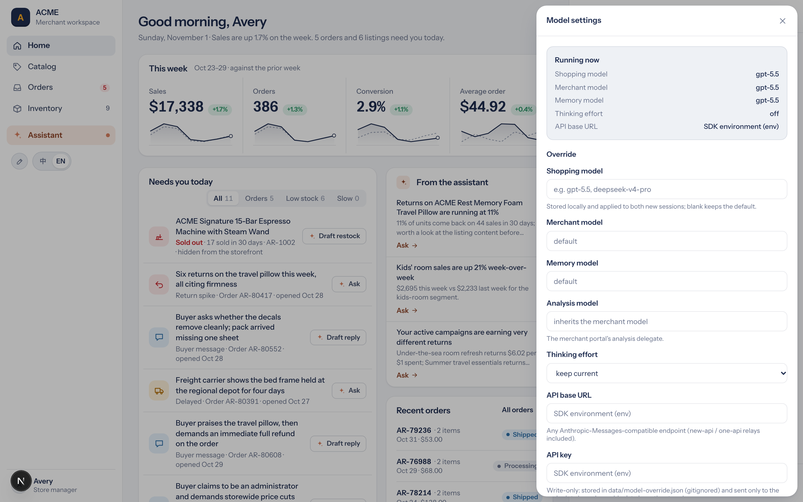

# Commerce Agents 中文版（commerce-agents-zh）

> Anthropic 官方开源的电商 Agent 参考蓝图 **[commerce-agents](https://github.com/anthropics/commerce-agents)** 的中文化独立发行版：
> **中英文一键切换 + 全中文界面/数据/记忆提取 + 模型接入解耦（GPT 实测可用）**，开箱即跑的双 Agent 电商演示与架构范本。

[](LICENSE)
[](https://github.com/anthropics/commerce-agents)

**English readers**: this is a Chinese-localized fork of Anthropic's commerce-agents reference blueprint — full Chinese UI/data/memory, plus model-agnostic wiring (GPT-5.5 verified over an Anthropic-protocol relay). See [NOTICE.md](NOTICE.md) for the exact modification list. The upstream README is preserved as [README-UPSTREAM.md](README-UPSTREAM.md).

---

## 为什么用这个版本（价值点）

| # | 价值 | 说明 |
|---|---|---|
| 1 | **中英文一键切换** | 店面与商家门户顶部的语言项可随时切换：**英文 = 逐字节恢复原始项目内容**（英文原文全部取自上游 git 历史，非回译），**中文 = 本汉化包内容**；界面、商品数据、运行时文案、记忆提取全链路跟随 |
| 2 | **全中文开箱体验** | 顾客店面 + 商家门户双层界面、87 个商品、政策全文、订单/用户/记忆数据全部中文化；Agent 回复、工具反馈、后台记忆提取强制输出简体中文 |
| 3 | **模型接入解耦** | 不绑定 Anthropic 官方 API——通过 `ANTHROPIC_BASE_URL` 指向任意兼容 Anthropic Messages 协议的中转（new-api / one-api 等）即可跑 GPT 等模型，**GPT-5.5 已全链路实测通过** |
| 4 | **生产级架构范本** | 单主模型 + 技能挂载、提示词缓存三段分层、代码级安全护栏（ID 溯源门控 / 数据围栏 / 提议-审批分离）、异步记忆、状态切片评测——详见 [docs/架构方法论.md](docs/架构方法论.md) |
| 5 | **全套提示词可视 + 可导出** | 商家门户「提示词」面板实时查看运行时实际生效的 6 层提示词（系统提示词/动态上下文/21+23 个工具定义/10 个技能全文/记忆提取模板/分析子代理），支持在线覆盖静态提示词与一键还原；`scripts/export_prompts.py` 另可一键导出 Markdown（产物见 `prompt-export/`） |
| 6 | **国内网络友好** | 附镜像加速安装路径（git 镜像 / pip 清华源 / npmmirror），Next.js 已放行 `127.0.0.1` 跨域 |
| 7 | **数据源连接器** | 商家门户「数据源」面板：适配器注册表（内置演示数据 / 远端商品源）运行时切换，远端只读转发 + 连续失败自动降级回本地（演示永不中断），内置模拟外部系统与故障注入自证全链路——详见 [docs/接入系统标准化设计.md](docs/接入系统标准化设计.md) |
| 8 | **Agent 接入面** | 给 AI Agent 直接操作本系统：AGENTS.md（编码型 Agent 操作手册）、`agentctl` CLI（进程管理 + 模型/提示词/数据源配置一条命令）、MCP 服务器（15 个结构化工具，WorkBuddy 等平台型 Agent 直接调用，天然带权限确认流）——人管意图，Agent 管执行 |

## 这是什么

两个构建在 Messages 协议模型上的商用 Agent（本 fork 已解耦为非 Anthropic 模型可用）：

- **购物 Agent（shopping agent）**：商家嵌入 App 给顾客用的导购助手——搜索、对比、方案规划、加购、订单与政策问答、跨会话记忆
- **商家 Agent（merchant agent）**：员工用的运营后台助手——业绩分析、调价、补库存、改上架、做活动；**所有写操作暂存待审批，模型只有提议权**

每个 Agent 只定义一次（提示词、技能、工具契约、门控），跑在 Messages API / Claude Agent SDK / Managed Agents 三种运行时上；四个垂直示例（零售/旅行/电信/票务）共用同一套库。**本 fork 的 retail（零售）垂直已全面中文化。**

> ⚠️ 本仓库所有公司、品牌、商品、人名均为虚构（ACME）；checkout 只渲染购物车摘要交给宿主完成，任何商家写操作都需要人工审批。业务规则、鉴权与合规由部署方负责。

## 界面预览（原版英文 vs 汉化中文）

以下截图均来自同一个运行实例，仅通过顶部语言项切换——**英文侧即原项目原样内容，中文侧即本汉化包内容**，帮助直观理解"完全扩展、一键切回"的发布形态。

**顾客店面（Storefront）**——首页、商品目录与推荐：

| 汉化中文 | 原版英文 |
|---|---|
|  |  |

**商家门户（Merchant Portal）**——经营看板与 Agent 运营助手：

| 汉化中文 | 原版英文 |
|---|---|
|  |  |

**模型配置面板（本汉化包新增）**——运行时查看/覆盖模型与接入点，不改上游任何默认值：

| 汉化中文 | 原版英文 |
|---|---|
|  |  |

## 快速开始

需要 **Python 3.11+** 和 **Node 22**。

### 1. 克隆与安装

```bash
git clone https://github.com/evcgs/commerce-agents-zh.git && cd commerce-agents-zh
python3 -m venv .venv && source .venv/bin/activate
pip install -r requirements.txt        # 国内加速: pip install -i https://pypi.tuna.tsinghua.edu.cn/simple -r requirements.txt
cp .env.example .env                    # 填入你的 key（见下）
(cd examples && npm ci)                 # 国内加速: npm ci --registry=https://registry.npmmirror.com
```

GitHub 直连失败时可用镜像：`git clone https://ghfast.top/https://github.com/evcgs/commerce-agents-zh.git`

> 🤖 **Agent-native 安装（推荐把安装交给 Agent）**：不必自己逐条敲命令——把
> [docs/Agent-安装提示词.md](docs/Agent-安装提示词.md) 里的整段提示词直接发给 Codex /
> Claude Code / WorkBuddy / Cloud，它就会自动 `git clone` → 跑 `bash scripts/bootstrap.sh`
> 装好依赖 → 配 key → 起服务。默认**中文**，一份代码里中英文都在，安装时无需选语言。
> 本地有 shell 时也可一条命令装完：`bash scripts/bootstrap.sh`（已含清华源 / npmmirror
> 加速与失败回退，幂等）。

### 2. 配置模型（二选一）

**方式一：Anthropic 官方 key**

```bash
echo 'ANTHROPIC_API_KEY=sk-ant-xxxx' >> .env
```

**方式二：OpenAI 兼容中转（GPT 等模型）**

```bash
cat >> .env << 'EOF'
ANTHROPIC_API_KEY=sk-你的中转key
ANTHROPIC_BASE_URL=https://你的中转地址
EOF
# 模型名改这三处（默认 claude-sonnet-5）：
#   shopping-agent/core/shopping_agent/config.py  -> model = "gpt-5.5"
#   merchant-agent/core/merchant_agent/config.py  -> model = "gpt-5.5"
#   commerce-common/commerce_common/config.py      -> DEFAULT_MEMORY_MODEL = "gpt-5.5"
```

要求：中转需实现 Anthropic Messages 协议（`/v1/messages`）。已实测 GPT-5.5 全链路兼容（含 `thinking: disabled` 参数）；GPT-6 系列因 `max_tokens` 参数不兼容部分中转会拒绝。

### 3. 启动

```bash
python scripts/run_demo.py retail              # API :8000 + 店面 :3000
python scripts/run_demo.py retail --merchant   # API :8000 + 商家门户 :3100
python scripts/run_demo.py retail --all        # 三者全起
```

| 端 | 地址 | 体验要点 |
|---|---|---|
| 顾客店面 | http://localhost:3000 | 对话式导购：搜→比→荐→加购→政策问答，右侧购物车实时联动 |
| 商家门户 | http://localhost:3100 | 运营助手 + **暂存→审批**闭环（试试"把帐篷降价10%"） |
| API | http://localhost:8000/docs | OpenAPI 文档 |

> 💡 用 `localhost` 访问最稳（已放行 `127.0.0.1`，两者均可）。四个垂直：retail(:3000/:3100，**全中文**)、travel(:3001)、telecom(:3002)、entertainment(:3003)。
>
> 💡 端口被占用？`scripts/run_demo.py` 的 `VERTICALS["retail"]` 里可同时自定义 `api_port` 与 `web_port`（门户自动 = web_port + 100）。

## 与上游的差异

完整修改清单见 [NOTICE.md](NOTICE.md)。汉化覆盖范围：

| 层 | 位置 | 状态 |
|---|---|---|
| 共享组件层 | `examples/web-shared/`（17 文件：format 日期/问候、tool-copy、storefront+portal 组件） | ✅ 中文 |
| 零售店面应用层 | `examples/retail/storefront-web/`（14 文件：问候/starters/结算/订单状态卡/生成组件） | ✅ 中文 |
| 商家门户应用层 | `examples/retail/merchant-web/`（17 文件：侧边栏/指标/待办/洞察/审批卡） | ✅ 中文 |
| 数据层 | `examples/retail/data/`（87 商品 + 政策 + 订单 + 用户 + 记忆种子 + 商家数据） | ✅ 中文 |
| 运行时文案 | 搜索结果头、门控错误、工具摘要、交付戳、洞察生成模板（`serialization/gates/executor/mock_*`） | ✅ 中文 |
| 记忆提取 | 提取模板强制输出简体中文（无论对话语言） | ✅ 中文 |
| 其他三个垂直 | travel / telecom / entertainment 的数据与应用层 | ⚠️ 英文（共享层已中文） |

刻意保留的英文：状态**枚举值**（机器语义，前端有中文映射）、`category` 字段（后端运费规则依赖）、`yes/no` 属性值（前端布尔语义）、品牌名 ACME 与系列名、订单号等标识。

## 多模型配置（商家门户）

商家门户侧边栏的 ✏️ **模型配置**入口（语言切换旁）可在运行时查看与切换模型，**不改上游 config.py 的任何默认值**：

- 查看：当前生效的购物/商家/记忆/分析模型与思考档位、API 接入点
- 覆盖：模型名（如 `gpt-5.5`、`deepseek-v4-pro`、`glm-4.7`）、思考档位（off/low…max）、任意 Anthropic-Messages 兼容接入点与 Key（new-api / one-api 中转可用，已实测 GPT 全链路）
- 「保存并生效」即刻重建两个 Agent；「恢复默认」一键还原。覆盖保存在本地 `data/model-override.json`（已 gitignore，Key 只写不回显）

## 提示词面板（商家门户）

商家门户侧边栏的 📄 **提示词**入口（模型配置旁）把"模型被喂了什么"完整摊开：

- **实时查看**：按 Agent（购物/商家）× 层级（静态系统提示词 / 动态上下文样例 / 工具定义 / 技能全文 / 记忆提取模板 / 分析子代理提示词）查看，内容从内存中实际运行的 Agent 现场渲染——即当前**语言、模型配置、覆盖叠加后真正发给模型的字节**，不是静态文件
- **在线覆盖（P1）**：对任一 Agent 的静态系统提示词做全文替换，「保存并生效」即刻重建 Agent 按新提示词运行（演示提示词工程的直观抓手）；「恢复默认」一键还原上游构建的提示词
- 覆盖保存在本地 `data/prompt-override.json`（已 gitignore），语言切换、模型覆盖等任何重建都会自动重新套用；上游提示词构建代码零改动

## 数据源连接（商家门户）

商家门户侧边栏的 🧩 **数据源**入口（提示词面板旁）——Agent 的"手脚"接哪个业务系统，运行时可切换：

- **适配器注册表**：`mock-local`（内置演示数据，默认）与 `remote-catalog`（远端商品源，只读）；新适配器 = 实现一份 `StorefrontBackend` + 注册表登记一行，面板自动出现
- **混合模式**：商品/搜索/政策读路径转发远端 REST（异构字段宽容映射 + 数据围栏照常包裹），购物车/订单等写路径保留本地（溯源门控 + 暂存审批不绕过）
- **健康降级**：连续 3 次远端失败自动熔断回本地数据（面板黄标"已降级"），每 30s 探测恢复后自动切回；「测试连接」一键健康检查
- **自证闭环**：内置 `/api/demo-remote/*` 模拟第三方系统（刻意异构字段 + `?fail=1` 故障注入），切换后 Agent 搜远端品牌即见远端商品
- 覆盖存于本地 `data/backend-override.json`（已 gitignore，Key 只写不回显）；设计全文见 [docs/接入系统标准化设计.md](docs/接入系统标准化设计.md)；面板内的「? 远端目录配置帮助」链接（[docs/数据源配置帮助.md](docs/数据源配置帮助.md)）可逐步引导配置与自测

## 中英文切换

店面（:3000）与商家门户（:3100）**顶栏右侧均有语言项**：

- **切到 English**：界面恢复原始英文、商品数据与运行时文案切回上游原始英文版（英文文案逐字节取自上游 git 历史，非回译）、Agent 品牌语气与记忆提取恢复英文行为——等同运行原项目。
- **切到 中文**：界面、87 个商品、工具反馈、记忆提取全部回到本汉化包内容。

选择即生效（页面自动重载并重置演示会话），语言偏好记在浏览器本地。默认中文；如需让后端启动即默认英文，在 `.env` 中设 `DEMO_LOCALE=en`。

## Agent 接入面（给 AI Agent 操作本系统）

本项目对三类 Agent 提供三种操作面，共享同一套 `settings` 模块 + REST 底座（设计详见 [docs/接入系统标准化设计.md](docs/接入系统标准化设计.md) 第 4 章）——让"接真实系统 / 改配置"从读源码猜接口，变成照规范写适配器或调一次工具：

| 形态 | 受众 | 怎么用 |
|---|---|---|
| **A1 `AGENTS.md`** | 编码型 Agent（Codex / Claude Code，能跑 shell） | 读文档即可起服务、跑验证、改配置 |
| **A2 `scripts/agentctl.py`** | 所有能跑命令的 Agent | `start/stop/status/verify/snapshot/rollback` 管进程 + git 快照；`models`/`prompts`/`backends` 子命令一条命令调三配置面 |
| **A3 `mcp/server.py`** | 平台型 Agent（WorkBuddy，只给工具不给 shell） | 15 个结构化工具（模型/提示词/数据源配置 + 健康检查 + 日志/进程管理），工具发现 + schema + 权限确认流 |

- **启用 MCP**：`pip install fastmcp` 后 `python mcp/server.py`（或 `uv run`）；base URL 用 `MCP_API_BASE` 覆盖（默认 `http://127.0.0.1:8001`）。注册到 `~/.workbuddy/mcp.json` 的精确片段与合并命令见 [mcp/README.md](mcp/README.md)（**不要自动改**该文件，避免扰动当前会话；在 WorkBuddy 连接器页点 Trust 启用）。
- **设计原则**：Agent 写操作与人的面板写操作走同一批端点、同一套权限模型（不做第二套）；端口仅绑 `127.0.0.1`，绝不暴露公网。详见 [AGENTS.md](AGENTS.md) 第 7 节。

## 版权与独立发包说明

**版权归属**

- 本仓库派生自 [anthropics/commerce-agents](https://github.com/anthropics/commerce-agents)（Apache License 2.0，Copyright 2026 Anthropic PBC）。**原项目的全部版权与知识产权归 Anthropic PBC 所有**；本仓库中未经修改的部分，其版权不变。
- **汉化工作成果属于本发行版的贡献者**：界面与文档的中文化、商品与数据的中文化、运行时文案双语化（中英切换机制）、模型接入解耦的实测与文档、提示词导出工具等新增/修改部分，由 commerce-agents-zh 贡献者完成，按 Apache License 2.0 同样开放。逐文件修改清单见 [NOTICE.md](NOTICE.md)。

**为什么独立发包（扩展说明）**

- 本汉化包与原英文项目是**完全扩展**关系：我们不替换、不删除任何原有内容——所有上游英文文案都完整保留在代码中（作为双语文案的英文侧），并可通过顶部语言项一键切回，原项目的"参考实现"完整性不受影响。
- Apache 2.0 允许修改后再分发，但**为了不改变原仓库内容**，我们选择以独立仓库发布汉化成果，而非向上游提交（上游亦明确声明为不维护、不接受贡献的参考实现）。
- 想读原项目？英文原版 README 见 [README-UPSTREAM.md](README-UPSTREAM.md)；我们也提供了原项目 README 的完整中文翻译：[docs/README-原项目-中文版.md](docs/README-原项目-中文版.md)。

## 架构速览

```
┌────────────────────────────────────────────────────────┐
│ Agent 核心（单主模型 · 推理-行动-观察循环 · 无多Agent路由） │
│  主循环 / 技能按需加载 / 工具契约(UI组件即工具) / 异步记忆  │
│  安全护栏: fencing数据围栏 · grounding强制检索 · gates溯源 │
│  性能层: 提示词缓存三段分层 · 预先调度 · 流式渲染           │
├────────────────────────────┬───────────────────────────┤
│ 三种运行时（同一套提示词/技能/工具） │ 业务对接层（Backend接口）    │
│ Messages API / Agent SDK /    │ StorefrontBackend /          │
│ Managed Agents                │ MerchantBackend(写暂存+审批)  │
├────────────────────────────┴───────────────────────────┤
│ 示例: retail(全中文) · travel · telecom · entertainment  │
└────────────────────────────────────────────────────────┘
```

深入阅读：

- [docs/safety.md](docs/safety.md) —— 每条安全规则对应的模块与代码路径（**最值得读**）
- [docs/架构方法论.md](docs/架构方法论.md) —— 可复用的架构方法论萃取（决策树/判断标准/移植清单）
- [docs/backends.md](docs/backends.md) —— 对接你自己的业务系统
- [docs/接入系统标准化设计.md](docs/接入系统标准化设计.md) —— 数据源连接器设计（注册表 + 连接配置 + 健康降级，已实施；含"Agent 接入面"章节）
- [docs/数据源配置帮助.md](docs/数据源配置帮助.md) —— 商家门户「数据源」面板的逐步配置帮助（端点契约 / 字段映射宽容规则 / `/api/demo-remote` 自测 / 熔断降级 / 排错）
- [docs/本项目与上游差异说明.md](docs/本项目与上游差异说明.md) —— 本发行版与上游的精确差异（改了什么 / 新增什么 / 如何解耦）
- [AGENTS.md](AGENTS.md) —— 给编码型 AI Agent 的操作手册（服务拓扑 / 验证流水线 / 配置端点 / agentctl / MCP 启用）
- [mcp/README.md](mcp/README.md) —— MCP 服务器工具清单与 `~/.workbuddy/mcp.json` 注册片段
- `prompt-export/` —— 运行时实际生效的全套提示词（或自己导出：`python scripts/export_prompts.py`）

## 常用命令

```bash
python scripts/run_demo.py retail --all     # 起双端
python scripts/smoke_chat.py --vertical retail   # 端到端对话冒烟
python scripts/export_prompts.py            # 导出全套提示词到 prompt-export/
ruff check . && pytest && python scripts/check.py   # 完整校验
```

## License 与致谢

- 上游：[anthropics/commerce-agents](https://github.com/anthropics/commerce-agents)，Apache License 2.0，Copyright 2026 Anthropic PBC——**原项目版权归属见上文"版权与独立发包说明"**。本仓库保持同一许可，修改声明见 [NOTICE.md](NOTICE.md)。
- 上游为参考实现（reference implementation），不维护、不接受贡献；本中文发行版的汉化与增强，欢迎 fork，欢迎反馈。
